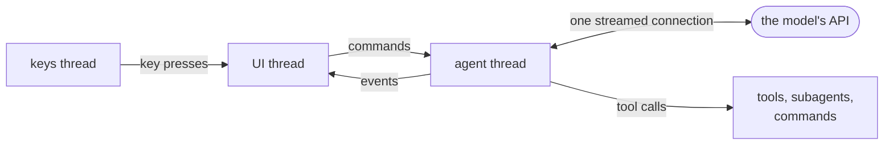
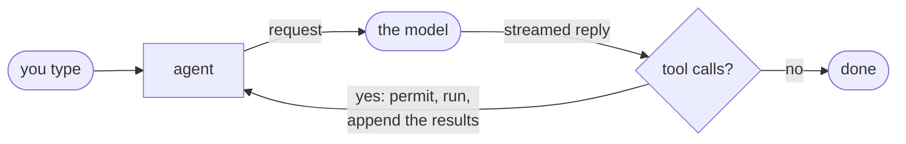
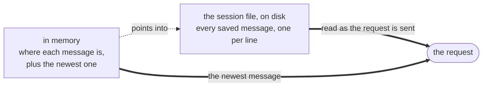

# How claude-jr works

Plain threads, a conversation kept on disk, and nothing else running.

## Threads

Four threads when idle, all asleep in the kernel, which is why waiting costs no CPU.

There is no async runtime and nothing polls: an idle session uses no CPU.

## One turn

Reads, subagents, skills and MCP calls in one reply run in parallel; edits and
commands run in order, each after the permission check.

## Where the conversation lives

- **On disk, not in memory.** A saved message is a line in the session file; memory keeps where it is. A long session uses the same memory as a short one.
- **Stored as it is sent.** A message is the exact JSON the API gets, so a request is streamed straight from the file.
- **Append-only.** Nothing already sent is edited, which keeps the provider's prompt cache valid.
