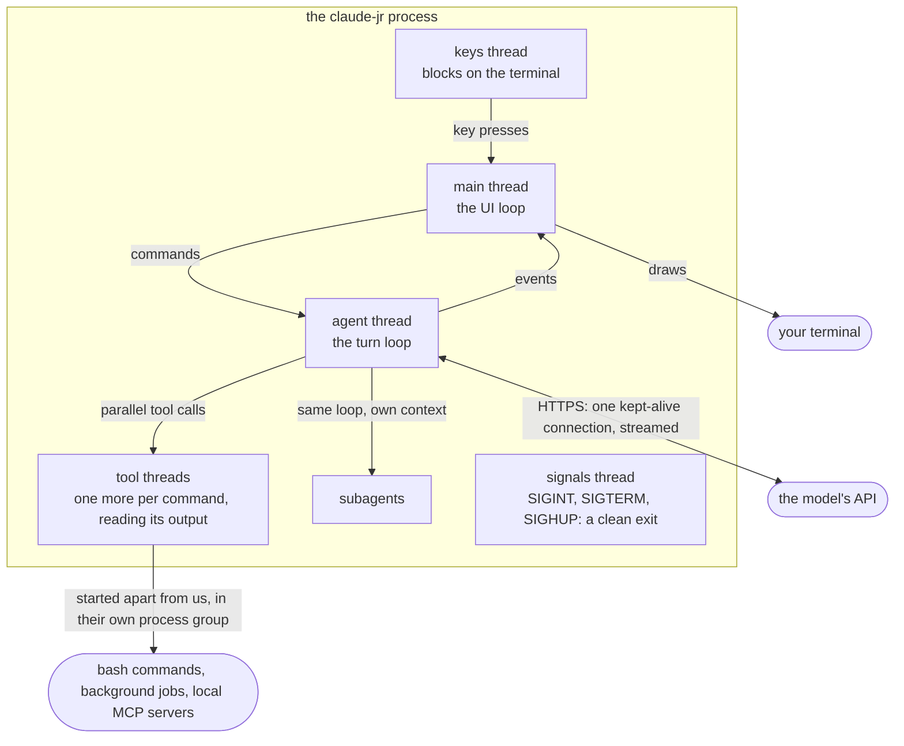
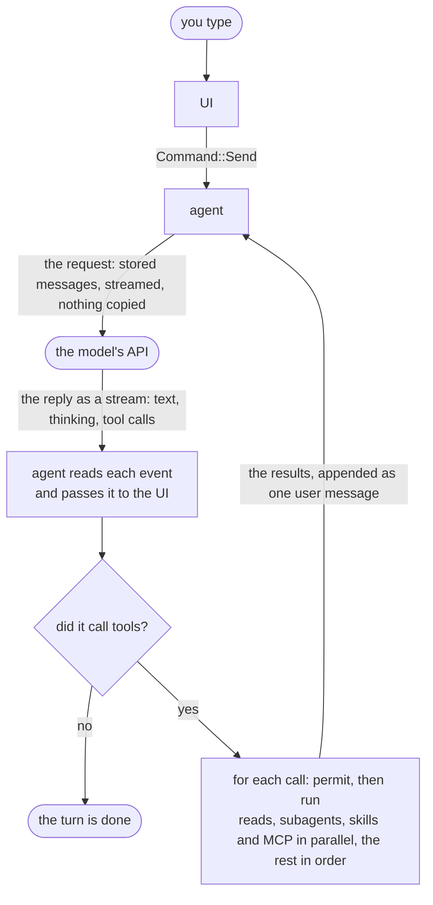
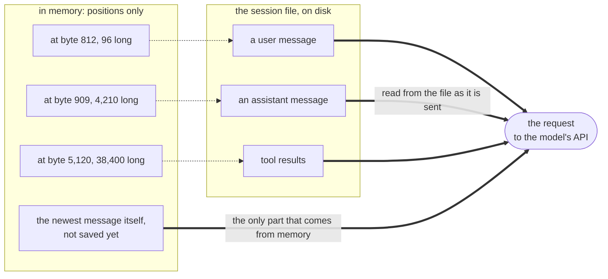

# How claude-jr works

## Threads and processes

claude-jr is multi-threaded, with plain OS threads and blocking I/O. There is
no async runtime and no io_uring. Each thread spends almost all its time
blocked in the kernel, so an idle session uses no CPU.



| Thread | Blocks on | Wakes when |
|---|---|---|
| main (UI) | the event channel | a key, an agent event, or every 300 ms while working (status dot); at most ~30 draws/s while streaming |
| keys | `read()` on the terminal | you press a key |
| agent | the command channel, then the socket | you send something; each network packet while a reply streams |
| signals | a signal pipe | SIGINT, SIGTERM or SIGHUP |
| bash-out / job-out | the command's output pipe | the command prints |
| mcp-read | the server's stdout | the server replies |

Idle, that's 4 threads (main, keys, agent, signals), all blocked.

## One turn



Approval (`agent/permit.rs`): mode → allow rules → (auto mode) the reviewer
model → ask you. Plan mode refuses edits; skip-permissions allows everything.

## Data: what is kept where



Data-oriented choices, and why:

- **Stored in the form it's used.** A message is the exact JSON text the API
  gets, never a tree of parsed values. Sending, saving and resuming all use
  the same bytes.
- **On disk, not in memory.** Once a message is saved, memory keeps only where
  its line is. A long session then takes no more memory than a short one.
- **Append-only.** New messages are added; old ones are never edited. This
  keeps the API's prompt cache valid, keeps the model's earlier reasoning
  valid, and makes the session file a plain append.
- **No copies on the hot path.** A request body is a list of pieces (bytes in
  memory, stretches of the session file, images encoded as they are read)
  streamed to the socket. Tool output is cut to 50 KB (start and end) as it's
  read, so a noisy command never sits in memory whole.
- **Translated once.** For providers that speak Chat Completions, each saved
  message is translated once and the result kept in a scratch file, so later
  requests read it like any other saved message.
- **Unused code handed back.** When the app goes quiet it gives the pages of
  its own program file back to the kernel, which is why it idles in less
  memory than its own size.
- **Batched UI work.** Events are drained in batches and drawn once per frame;
  only changed lines are rewritten; finished rows go to scrollback once.

Memory in practice: 0.7 MB idle, about 2 MB while working, and under 4 MB at
its peak however long the session runs.

## Files

```
src/
  main.rs            parse the command line, hand over to cli/
  cli/               one file for each thing you can type
    args.rs          the flags and the usage text
    start.rs         claudejr and claudejr -p: start-up checks, then the UI or print
    print.rs         -p: one prompt, the reply printed (text, JSON, or a stream of steps)
    sessions.rs      --sessions
    update.rs        --update
    task.rs          claudejr task ...
    fleet.rs         claudejr fleet ...
    mcp.rs           claudejr mcp: tasks served to another agent
    install.rs       claudejr install / uninstall
  ui/                the interactive terminal
    mod.rs           the event loop
    app.rs           the state, the scrollback, the live area
    events.rs        what the agent reports
    keys.rs          key presses, prompts, settings
    commands.rs      what is typed and sent, slash commands
    term.rs          raw mode, scrollback, line-diff redraw
    history.rs       what was drawn, kept to draw again at a new width
    view.rs          tool blocks, diffs, boxes, status, footer, mascot
    md.rs  table.rs  text.rs   Markdown, tables, styles and wrapping
    input.rs  paste.rs         the line editor, pasted text
    stats.rs         /stats
  agent/             the loop
    mod.rs           the agent thread: start-up, commands, sending a message
    turn.rs          one turn: ask, run tools, repeat (shared with subagents)
    permit.rs        modes, approval, auto mode's reviewer
    sub.rs           subagents, in worktrees of their own when asked
    compact.rs       /compact
    history.rs       rewind, resume, the transcript
  tools/             what the model can do
    mod.rs           definitions, dispatch, shared state behind locks
    fs.rs            read, write, edit
    bash.rs          bash, background jobs, the jobs tool
    mcp.rs           MCP servers over stdio, and the API's connector for remote ones
    skill.rs  memory.rs  todo.rs  checkpoint.rs
  api/               talking to models
    mod.rs           the client: where a request goes, retries, cancelling
    body.rs          the request body, streamed from memory, files and images
    stream.rs        reading an event stream line by line
    anthropic.rs     the Messages format
    openai.rs        the Chat Completions format, translated both ways
    provider.rs      which provider a model id names
    cloud.rs         Claude through Amazon Bedrock or Google Vertex AI
    bedrock.rs       Bedrock's address, login and request signing
    vertex.rs        Vertex's address and access token
    models.rs        prices, context sizes, what each Claude model supports
  work/              running many
    task.rs          background tasks: start, state, wait, cancel, merge, drop
    budget.rs        a group's shared budget
    worktree.rs      a git worktree and branch for a run
    log.rs           the run log: every step as a JSON line
  store/             what is kept on disk
    session.rs       conversations as JSONL, read back in place
    images.rs        pasted and attached images
    config.rs        config files, the saved API key, trusted folders
  sys/               what depends on the operating system
    os.rs            files and processes, on Unix and on Windows
    shell.rs         the shell commands run in (bash; on Windows Git's, or PowerShell)
    sandbox.rs       re-exec inside bubblewrap (Linux)
    mem.rs           handing unused program pages back (Linux)
    signals.rs       clean exit on signals, or on Windows when the console closes
  permission.rs      allow rules
  prompt.rs          the system prompt, AGENTS.md, notes

tests/
  cli/               the real binary against the fake API, a file per area
  ui/                the real binary in a pseudo-terminal

bench/               measurements and checks; see bench/README.md
```

Files stay under about 500 lines of code. Where a file's tests are longer
than the code, they sit beside it (`api/tests.rs`, `agent/tests.rs`).
