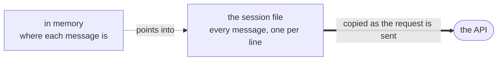

# How a coding agent fits in 2 MB and 0.7 MB of memory

Claude Code installs 354 MB and holds 148 MB while it waits for you to type.
claude-jr does the same kind of work, and resolves 93.4% of SWE-bench
Verified, as one 2 MB file that waits in 0.7 MB. Nothing in it is clever.
This is where the bytes go, and the few decisions that keep them there.

## What the 2 MB is

The release binary is 2,034,464 bytes. Adding up everything in it that
carries a name:

| | KB | share |
|---|---:|---:|
| TLS and cryptography (rustls, ring) | 616 | 36% |
| claude-jr itself | 400 | 23% |
| Rust's standard library | 333 | 19% |
| HTTP (ureq) | 130 | 8% |
| C library (musl) | 92 | 5% |
| stack unwinder | 51 | 3% |
| JSON (serde_json) | 32 | 2% |
| terminal and signals | 28 | 2% |
| the rest | 28 | 2% |

That is 1,710 KB; the other 280 KB is text, tables and the file's own
bookkeeping. More than a third of the file is the code that speaks HTTPS.
The agent (the terminal UI, ten tools, an MCP client and server, two wire
formats, sessions, background workers) is 400 KB.

## Nothing to load

It is a static binary: no JavaScript engine to start, no modules to read, no
garbage collector holding a heap in reserve. That is most of the difference
on its own. It starts in 4 ms where Claude Code takes 157.

There is no async runtime either. Four plain threads are enough: one reads
keys, one draws, one runs the turn, one watches for signals. They pass
messages over channels.

## Nine dependencies

`anyhow`, `base64`, `crossterm`, `ring`, `serde`, `serde_json`, `signal-hook`,
`unicode-width`, `ureq`: 72 packages once theirs are counted, with the
optional parts of the big ones switched off. What is usually a library is
written by hand, to the size this program needs: arguments in about 130
lines, Markdown in under 300, the reader for the model's event stream in 71.

## The build

The same source, built four ways (static, x86-64):

| | size |
|---|---:|
| Rust's default release build | 12.2&nbsp;MB |
| the same, stripped of symbols | 4.7&nbsp;MB |
| optimised for size as one unit, aborting on panic | 2.7&nbsp;MB |
| with the standard library rebuilt for size as well | 2.0&nbsp;MB |

The third row is five lines in `Cargo.toml` (`opt-level = "z"`, `lto`,
`codegen-units = 1`, `panic = "abort"`, `strip`). The fourth needs a nightly
compiler: it rebuilds the standard library with the same settings and leaves
out the tables used to unwind the stack, which a program that aborts never
reads.

## The conversation is on disk

An agent's memory usually grows with the conversation, because the
conversation is kept in memory and sent again with every request.

Here a message is saved as soon as it is complete, as one line of the session
file, in the exact JSON the API takes. Memory keeps only where each line is.
To send a request, the lines are copied from the file to the socket.



So a long session costs what a short one does: 3.9 MB at its peak after 20
tool calls or 200. Before this change, 200 calls peaked at 10.7 MB. Nothing
already sent is ever rewritten, which also keeps the provider's prompt cache
valid for the whole session.

## Idling in less than its own size

A 2 MB program waiting in 0.7 MB holds less than itself. The kernel maps a
program's pages in as they are first touched and leaves them there, so
whatever start-up or the last turn needed stays counted. Most of those pages
were never changed: they are copies of the file on disk.

Each time the UI is about to wait with nothing to do, it hands them back,
one `madvise` call per region. They return from the page cache the moment
they are needed. That took idle memory from 2.1 MB to 0.7 MB.

## Waiting without polling

When nothing is happening the four threads are blocked in the kernel: on a
channel, on the keyboard, on a signal. There is no timer, so an idle session
uses no CPU at all. Timers run only while there is work, and the screen is
redrawn at most 30 times a second however fast text arrives.

Polling crept in twice, and both times it cost time rather than CPU:

- Commands were noticed by checking on a timer whether they had finished.
  Waiting on their output instead took 60 tool calls from 0.81 s to 0.32 s.
- So that Esc could stop a request that had not answered yet, a watcher
  checked every 50 ms, and each request waited for the watcher to finish.
  60 tool calls went from 0.4 s to 3.2 s. Now the request wakes the watcher
  when it ends.

## What it costs

- **A nightly compiler** for the smallest build. Stable Rust builds it too, at 2.7 MB.
- **A panic ends the program** where it stands. The session is on disk already, so `claudejr -c` carries on from it.
- **Threads, not thousands of connections.** Many agents means many processes, at about half a megabyte each.
- **Less in the box.** No plugins, hooks or IDE integration.
- **The memory figures are Linux's.** The macOS and Windows builds don't hand pages back when idle.

## Check it

```sh
curl -fsSL https://claudejr.iwhitebird.com/install | sh
claudejr        # then type /stats
```

`/stats` prints what the process holds right now. The
[benchmarks page](BENCHMARKS.md) has every number and the script that
measured it. The figures here are for the Linux x86-64 build of 19 November
2026; the breakdown was made with `nm` on a build that keeps its symbol
names.
